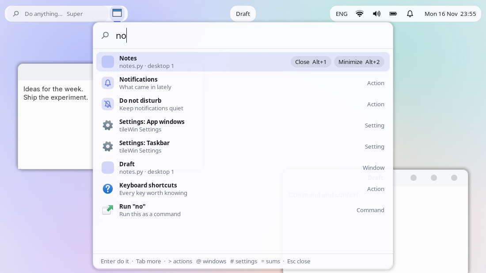
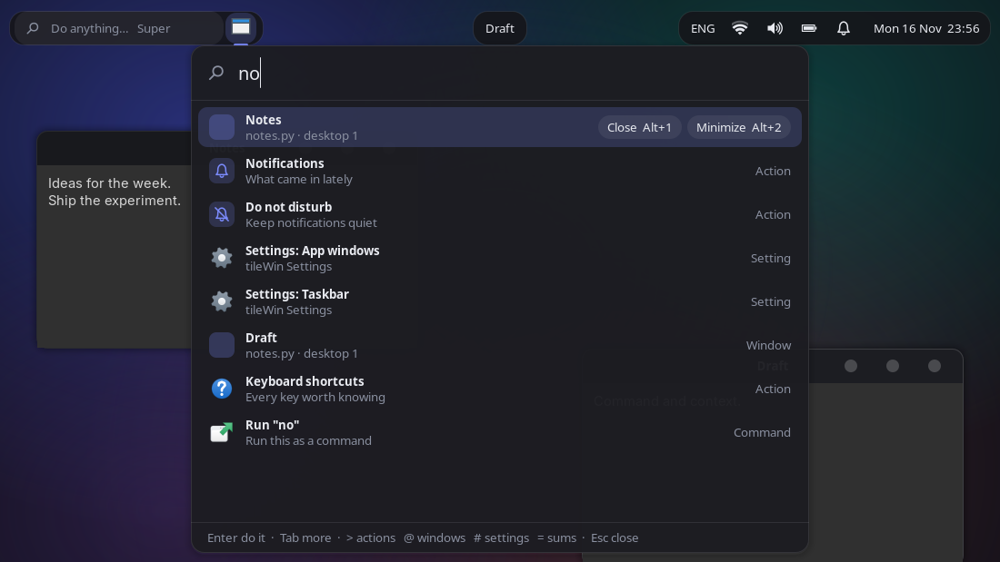

# modernCC: command & context

An experiment in a faster way to work with a desktop, built as a tileWin theme
(`tilewinmsg theme moderncc`, or the Theme page). It lives on the branch
`experimental/moderncc` until it has proven itself.

## The idea

Most desktops make you **navigate** to things: open a menu, find a folder of
apps, find the app, or find its window on a taskbar. Each step is a look, a
move of the pointer and a click, and the steps differ for apps, windows,
settings and the things the system can do. modernCC replaces the navigating
with one **command** and keeps the **context** in sight:

1. **One place to start anything.** Super, or the capsule at the left of the
   bar, opens the Command Center in the middle of the screen, where the eyes
   already are. Whatever is typed finds, in one list, the open windows, the
   apps, the things tileWin can do (lock, sleep, dark mode, Wi-Fi, do not
   disturb, task view, a screenshot, another theme, …), settings pages, files
   and sums. There is nothing to learn about where something lives.
2. **No typing for the usual things.** Before anything is typed it shows the
   open windows (the one you came from first, so Super and Enter go back to
   it) and what you use most and lately. What is used often rises by itself
   (`~/.local/state/tileWin/command-center`).
3. **What is open comes before starting it again.** A window that matches
   ranks above the app it belongs to, so typing the name of an app that is
   already open goes to it instead of opening a second one.
4. **More than one thing to do with a result.** Enter does the obvious thing;
   the chosen row shows what else it can do as chips (a window: Close,
   Minimize), reached with Tab or at once with Alt+1 to Alt+3.
5. **Signs narrow it down** for those who know what they want: `>` the actions,
   `@` the windows, `#` the settings, `=` a sum. Matching forgives: the start of
   any word ("scr" finds Take a screenshot), initials ("tv" finds Task view),
   and from four letters on, letters in order.
6. **A slim bar of context along the top.** Three floating capsules: what to do
   (the Command Center's field and the running apps), what is in front (the
   window's name, a click for its menu), and how things are (network, sound,
   battery, notifications, the time). The bottom of the screen is left to the
   windows, and the top is where window titles and menus are anyway.
7. **Quiet windows.** A thin line and round corners, the title in the middle,
   three small round buttons that show their signs only while the pointer is on
   them, the close button red then. Nothing competes with the content.

## Keys

| Key | |
|---|---|
| Super | the Command Center |
| type | find anything |
| Enter | do it: switch to the window, open the app, run the action |
| Tab / Shift+Tab | the other things the chosen row can do |
| Alt+1 … Alt+3 | one of them at once |
| `>` `@` `#` `=` | only actions, windows, settings, a sum |
| Esc | empty the field; again, close |

Everything else of tileWin works as in the other themes: Super+Tab task view,
Super+arrows to snap, Super+Shift+W tile mode.

## Made for it

- `panel/commandcenter.c`: the Command Center (also `tilewinmsg panel command`,
  and `startmenu.layout command` in any theme).
- `common/tw_command.c`: matching and the history of use, tested by
  `tests/test_command.c`.
- `sway/wm/styles.c`, `style cc`: the window frame.
- `search.style box` and `search.radius`: the search widget as a field in any
  theme.
- `themes/moderncc`: the theme, light and dark; its wallpapers are drawn by
  `tools/gen-moderncc-wallpaper.py`.
