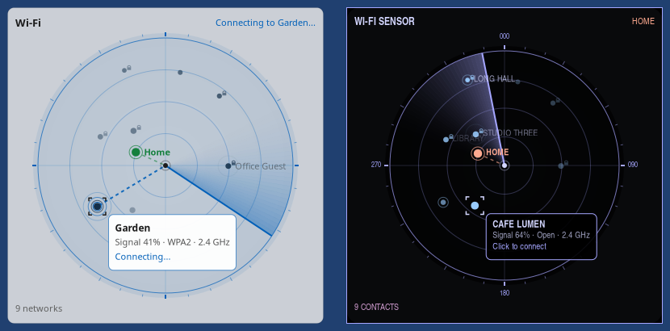

# Using tileWin

The parts of the desktop in more detail: keys, flyouts, the settings app, the themes and the screen savers. The [README](../README.md) is the short tour; every setting by hand is in [configuration.md](configuration.md).

## Updating

```sh
tilewin-update           # asks which way
tilewin-update release   # the newest release
tilewin-update source    # the newest source
```

The **Updates** group of the About page in the settings does the same with two buttons. There are two ways:

- **The newest release** from GitHub: its ready-made archive, checked against the `SHA256SUMS` of the release, when this computer has the libraries it needs and tileWin lives in `/usr/local`. Otherwise the source of that release is built instead. Nothing happens when you have it already (`--force` goes on anyway).
- **The newest source:** the repository is pulled into a temporary folder and built there. The folder is deleted afterwards, also when the build failed.

Either way tileWin is restarted after a good update with `tilewinmsg restart` (`--no-restart` leaves that out), and the password is asked for once: by sudo in a terminal, by pkexec from the settings. By hand it is still `git pull && ./install.sh --no-deps && tilewinmsg restart` in a clone of your own.

`restart` keeps your windows open, always: the config, the theme, the taskbar and the other programs of tileWin start afresh while the windows stay where they are. The helpers that run all session (`tilewin-nightlight`, `tilewin-clipboard`, `tilewin-polkit`) are started again when the update replaced them, so their fixes come in too; the clipboard history then keeps only its pinned entries. At its end install.sh says which of this applies: what a restart brings in, and whether the compositor itself changed. A Wayland app has no way to survive the compositor it is talking to (the display socket goes with it and no toolkit knows how to reconnect), so when an update replaced the compositor itself, the new one starts with your next login, and a notification says so. To start it at once: `tilewinmsg restart relaunch-apps` starts your apps again and puts them back where they were, `tilewinmsg restart session` only ends the session. If only the taskbar changed, `tilewinmsg restart panel` is enough.

## Volume, brightness and media keys

The volume, microphone mute, brightness and media player keys work in both modes (also on the lock screen) and show a popup like on Windows. A `bindsym` for the same key in your config replaces the default.

The same can be done from a terminal with `tilewin-media`:

```sh
tilewin-media                  # show volume, microphone, brightness and music
tilewin-media volume up        # louder (volume down: quieter)
tilewin-media volume 40        # set the volume to 40%
tilewin-media volume 120       # louder than 100%, amplified (up to 130%)
tilewin-media mute             # mute or unmute
tilewin-media mic              # mute or unmute the microphone
tilewin-media brightness 70    # set the brightness to 70% (up, down, +10, -10)
tilewin-media brightness 120   # brighter than the backlight goes (up to 130%)
tilewin-media play             # play or pause (next, previous, stop)
tilewin-media help             # all examples
```

It uses `wpctl`, `pactl` or `amixer` for audio, `brightnessctl` or `light` for the backlight and `playerctl` for music and video players.

### Volume over 100%

The volume goes on to 130%, for quiet speakers or a quiet video: over 100% PipeWire or PulseAudio amplify the sound in software, which can distort loud parts. The volume sliders of the quick settings, the volume flyout and the Sound page of the settings and the volume popup go on past a mark at 100%, the part past it tinted amber like the brightness over 100% (theme key `flyout.boost`); the volume keys, `tilewin-media volume up` and the scroll wheel on the volume icon go on past 100% in their steps and stop at 130%. The volume of single apps in the flyout and on the Sound page stays at 100% at most, as on Windows. With ALSA alone (`amixer`) the volume ends at 100%.

### The lowest brightness

The brightness goes down to 0%, which keeps the backlight on at 1%, so the screen never goes dark; from there the keys, the scroll wheel and the sliders go up in their steps to 5%, 10% and on.

### Brightness over 100%

The brightness goes on to 130%, for a sunny room: over 100% the backlight stays at full and the night light lifts the dark and middle tones of the picture with a gamma curve (out = in^(1/g), g from 1 at 100% to 1.6 at 130%: a middle grey of 50% shows as 65%, black stays black and white stays white). It is applied together with the night light's color temperature, in the same gamma tables, as only one program can hold those of a screen; so it needs `tilewin-nightlight` running (tileWin starts it) and a screen with gamma tables, and while the night light is not running the sliders end at 100%. So that 100% shows not to be the end, the sliders of the quick settings and the battery flyout and the brightness popup go on past a mark at 100%, with the part past it tinted amber (theme key `flyout.boost`) and filled amber as far as the boost goes, and show the percentage beside them; the Screen page of the settings has a mark at 100% and turns the filled part amber over it. The brightness keys and the scroll wheel on the brightness icon go on past 100% too, in the same steps. The boost is kept in `~/.local/state/tileWin/brightness-boost` (100 to 130) and comes back at the next login; `tilewin-nightlight boost` prints it and `tilewin-nightlight boost 115` sets it. The popup can also be shown on its own with `tilewinmsg panel osd volume|brightness <percent>`, `panel osd mic <muted>` or `panel osd media`.

## Keyboard shortcuts

`Super+/` or `Super+F1` (or `tilewinmsg panel shortcuts`) lists the keyboard shortcuts of the current mode. They are read from the compositor as the list opens (`tilewinmsg -t get_bindings`), so keys you changed are shown as they are now, and a command the list has no words for is shown as it is under *Other*.

The first three times the mode is switched, a notification says which keys go back: someone who lands in tile mode by accident has other keys there and no way of guessing them.

## Dark mode on a schedule

The Theme page turns dark mode on and off by the clock (`dark_schedule 21:00 07:00` in common.conf, `off` for never). It takes effect at once and when the session starts, and acts again only when the time passes a start or an end, as the night light does, so a change by hand lasts until the next of them.

## Low battery

On battery at 10% a notification says the battery is low, and at 5% an urgent one says it is almost empty, which also comes through do not disturb. This does not depend on the battery saver or keep awake. Being plugged in starts it over. The Battery saver group of the Screen page sets the level (`battery_warning 10`, half of it is the urgent one, `battery_warning off` for never).

## Battery history

The battery flyout (`panel power`, the battery icon of the taskbar) shows a chart of the charge over the last 24 hours, with the time it charged in green. The taskbar takes the charge down every five minutes and whenever it changes, in `~/.local/state/tileWin/battery-history`, which keeps the last two days, so the chart goes on after a restart. Nothing is taken down while the computer is off, asleep or hibernating: such a time is a straight line from the last reading before it to the first after it. Without a battery there is no chart.

## Screens at 125% or 150%

The taskbar, its menus and flyouts, the desktop icons and the notifications ask the compositor for the real scale of the screen (`fractional-scale-v1`) and draw for exactly the pixels they cover, so text and lines stay sharp on a screen with `scale 1.5`. Where the protocol is missing they draw at the next whole scale, which is shrunk to fit.

## First start

A new user is greeted by **Welcome to tileWin** (`tilewin-settings --welcome`): a theme and dark mode, window or tile mode, the keys worth knowing, and a way to restore a backup from another computer. Everything applies at once and *Skip* ends it. It comes once (`welcomed` in `~/.local/state/tileWin`); someone with a session behind them does not get it after an update.

## Theme cards

The cards of the **Theme** page show each theme's wallpaper with a small window and taskbar over it, drawn in the colors of that theme.

## Flyouts with the keyboard

Quick settings and the network, volume, battery, Bluetooth and notification flyouts work without a mouse. Tab and Shift+Tab walk through what can be clicked, the arrow keys go the way they point, a ring shows where you are, and Enter or Space click it. Left and Right change a slider. Esc closes the flyout. No ring shows until you press one of these keys, and while a password is being typed every key goes to the field.

## Search

The search box of the start menu (just start typing) and the launcher (`Super+S`) find more than apps:

- **Settings:** the pages of the settings app by the words people look for, so `dark mode` or `wifi` opens the right page.
- **Sums:** `6*7`, `200*10%`, `(1+2)^3`, `1,5+2`, or `=` before a lone number. The value is the first row, Enter copies it (with `wl-copy`).
- **Files and folders** in the home folder by a part of their name, up to six folders deep, without hidden folders. `find` looks for them in the background a moment after the last key, and is stopped by the next key.

In the launcher, a word that no app has gets a **Run** row first, so Enter runs a command as ever, even when a setting or a file has that name.

## Notifications and the Action Center

The taskbar is the notification service of the desktop (`org.freedesktop.Notifications`), so `notify-send` and apps show their notifications on it. They pop up above the notification area as toasts (Windows 10 and 11) or balloons (95, XP and 7) and then go to the Action Center: the bell button next to the clock, `Win+N` or `tilewinmsg panel notifications`.

- Click a notification to open the app, use its buttons, or close it with ×. Hovering keeps it on screen.
- The Action Center groups the history by app (kept across restarts, up to 50), with *Clear all* and a *Do not disturb* switch. Do not disturb (`panel dnd on|off|toggle`) only lets urgent notifications pop up.
- If another notification daemon (mako, dunst, …) is running, tileWin waits and takes over when it quits.
- Theme keys: `notifications.style toast|balloon`, `notifications.center side|flyout`, `notifications.bg`, `.fg`, `.border`, `.badge`.
- Configs from older versions get the bell button after the clock; `notifications_button no` in taskbar.conf keeps it away (the Settings app writes this when you remove it).

## Quick settings

`Win+A` (or `tilewinmsg panel quicksettings`) opens quick settings like on Windows 11: buttons for Wi-Fi, Bluetooth, airplane mode, do not disturb, night light and tile mode, sliders for volume and brightness (on to 130%, past a mark at 100%, see [Volume over 100%](#volume-over-100) and [Brightness over 100%](#brightness-over-100)), the battery and a link to the settings. The arrows next to Wi-Fi, Bluetooth and the volume open their own flyouts. In the Windows 11 theme the network, volume and battery icons of the taskbar open it too (theme key `panel.quick_settings`, or `quick_settings yes|no` on those widgets).

Wi-Fi uses NetworkManager (`nmcli`), airplane mode `rfkill`, the volume `pactl`, the brightness `brightnessctl`.

## Quick web

A web address typed a word a key. Give keys their words on the **Quick web** page (Taskbar & Start), for example g for `github.com/` and, after it, k for `ksmbl/`, and a shortcut to open it. Pressing g types `github.com/` at once, k then `ksmbl/`, and the keys that come next are shown under the field with their words. A key without a word types itself, and from there on the keys are letters; Shift types the letter itself anyway. Backspace takes a whole word back, Enter opens the address in the browser (with `https://` when it has no scheme of its own), Escape closes. There are no words until you give some. `panel quickweb` opens it too; the words are in `~/.config/tileWin/quickweb.conf`:

```
key g "github.com/" {
    key k "ksmbl/"
}
key y "youtube.com"
```

## App popups

An app that comes and goes with a shortcut: Thunderbird as high as the screen on its right, 70% wide, with the rest darkened behind it; a terminal from the top. On the **App popups** page (Windows), **Add popup** asks for the app, its position (left, right, top, bottom or the middle), its width and height in percent of the screen without the taskbar, how much to darken the rest, and the shortcut (pressed to record it), with a small picture of the screen that shows where it goes. Keys that already do something else are named; the popup takes them over. The first press starts the app if it does not run (or takes in its open window) and shows it there; pressing it again, clicking beside it or switching to another app hides it, still running, so the next press brings it back at once. ▶ on the page shows it right away to try it. It has no frame, slides in from its side and out again with the darkness fading along (**Comes in**: Slides in from its side, or Just appears; the animations of the settings switch it off too), and with **Open as popup everywhere** opening the app from the taskbar, the start menu, search, the desktop or the Command Center opens it as the popup as well. The details are in [configuration.md](configuration.md#app-popups-popupsconf).

## Clipboard history

`Win+V` (or `tilewinmsg panel clipboard`) lists the last 25 copied texts and pictures. Click one (or pick it with the arrow keys and Enter) to paste it into the window you were using; tileWin types Ctrl+V for you (Ctrl+Shift+V in terminals). Pin entries to keep them after a restart, × removes one, *Clear all* removes everything that isn't pinned.

Copies that password managers mark as secret are not recorded. The **Clipboard** page of the settings (under System, as on Windows 11) turns the history off (`clipboard_history no` in taskbar.conf), can have a picked entry only copied instead of pasted (`clipboard_paste no`) and clears the history but for the pinned entries.

The history is kept by **tilewin-clipboard**, a program of its own that the taskbar starts. A single copied picture can be sixteen megabytes, and keeping that inside the taskbar made the taskbar look like it was growing for no reason; in its own process a look at `htop` says plainly what the memory is for. The taskbar only holds a thumbnail and the first few hundred bytes of each text. It keeps running when the taskbar restarts, so the history survives `tilewinmsg restart panel`.

## Git

The **git** widget shows the branch, the newest tag reachable from HEAD and the lines added and removed of the repository the focused window is working in:

```
main  v1.0.7  ↑2  +42 -7
```

The directory comes from the kernel rather than from the shell: the focused window has a process, and the foreground process of its terminal has a `/proc/<pid>/cwd`. Nothing is sourced into a shell, so bash, zsh, fish and the rest behave identically. Terminals that serve every window from one process (`xfce4-terminal`, `gnome-terminal` and `konsole` in their default mode) cannot be told apart this way; start them with `--disable-server` (`--disable-factory` for gnome-terminal) to give each window its own process.

The reading **stays on the last repository it saw**, so moving to a browser or an editor leaves the outstanding work on screen instead of blanking it. Clicking opens a terminal in the repository. The tooltip adds the path, what is staged, changed, untracked or conflicted, and how far the branch is from its upstream. Theme keys `git.clean`, `git.dirty` and `git.conflict` color it; `interval` (default 5 s), `show_tag`, `icon` and `max_width` are widget options.

git is asked in the background — one shell running two git commands (the tag is asked once a minute), whose answers the taskbar reads when they are ready — so the bar never waits for a slow repository, and nothing runs at all while the widget is off screen.

## Kernel updates widget

The **Kernel updates** widget (taskbar and desktop) shows the state of the automatic kernel updates: a shield in the color of the state (green: up to date, or fixes applied live; the accent: downloading, building, making live fixes, applying; amber: a new kernel waits for the next restart; red: something failed; grey: off) and what goes on, with how far it is: "Downloading 7.3.6 · 15%", "Building 7.3.6 · 69%", "Fixed live: 7.3.6", "7.3.6 at restart". On the taskbar its text can be full, short (only the share, or the release waiting) or none, with a progress bar or without, and it can hide while all is well. On the desktop it is a **Card** (the shield, what goes on, a sentence more, a bar while busy, and the facts: running, live fixes, next start, last check), a **List**, a **Ring** or a **Bar** of how far it is, like on the taskbar, or a tile. A click opens a flyout in the look of the theme with all of it, the last things done, when it runs, and **Update now** (**Stop** while it runs, **Restart…** when a kernel waits), **Kernel page** and **Settings**.

## Wi-Fi radar



The **Wi-Fi radar** widget (desktop and taskbar, in every theme) shows the Wi-Fi networks in reach as contacts on a radar whose sweep goes round: the stronger a network, the nearer the middle, each at a bearing of its own that stays the same. The sweep lights a contact up as it passes and names it; a network that comes into reach closes in with a ring, one that leaves fades out, and when its signal changes it glides to its new distance. A ring around a contact is a saved network, a small lock one that needs a password, and the network connected to is tied to the middle by a beam.

The pointer on a contact shows its card: name, signal, security, band and what a click does. A click connects: to a saved network and to an open one at once, while rings go out from it and a beam runs to the middle, then a bright ring when it is there; when it fails, the contact is framed in red and its card says why. A network with a password that is not saved yet opens in the network flyout with the field for its password, as does a saved one whose password was turned down; a click on the network connected to opens its details there. A click on the empty radar sends a ping and looks for networks again, and with Wi-Fi off a click turns it on. A right click on a network opens its menu: **Connect** or **Disconnect**, **Details**, **Connect automatically** and **Forget this network** for a saved one, and **Look again**.

Bluetooth devices are on the radar too, as diamonds (`bluetooth no` leaves them off): connected ones near the middle, the others by their signal while Bluetooth looks around, paired ones out of reach at the rim, filled when paired and hollow when new. Their card names them and how they are, and a click connects or disconnects a paired one and pairs a new one.

On the desktop its style is **Radar** (3x3 cells by default, 4x4 shows more), or like on the taskbar, or a tile. On the taskbar it is a small radar with the strongest networks where they are, and how many there are (or the name of the one connected to, or nothing: Text on the taskbar); a click opens the network flyout. How fast the sweep goes round (`turn`, 6 seconds) and its color (`color`, the accent of the theme) are in its settings. It draws itself in the colors of the theme: a screen in the accent on light themes, a dark one on dark themes and straight on the wallpaper, ink on paper with hatching on the Atari ST, the bars' colours and capitals on the Starship Console, whose moving wallpaper is the same radar. It looks every 30 seconds with NetworkManager (`nmcli`), slows down with the battery saver, stops while windows cover it, and stands still while Wi-Fi is off.

## Open ports

The **Open ports** widget (taskbar and desktop) shows the ports programs on this computer listen on, and how far each can be reached: **Local** (only from this computer: 127.0.0.1, ::1), **LAN** (an address of a private network: 192.168.x.x, 10.x.x.x, 172.16–31.x.x, 100.64/10, link-local, fc00::/7) or **Public** (all addresses, 0.0.0.0 or ::, or a public address: every network the computer is on, the internet too when no router or firewall stands in between). On the taskbar a network socket in the color of the widest of them (green: all local, amber: one on a LAN, red: one public) and "2 public · 9 local"; its text can be full, short (how many are open to the network) or none, and it can hide while all ports are local. On the desktop it is a **List** with a line for each port, like on the taskbar, or a tile. A click opens a flyout in the look of the theme: the ports reachable from other computers, then those only for this computer, each with its port, program, protocol, address and a badge of how far it reaches. The program of another user's socket (root's sshd, cupsd) cannot be seen without root: the flyout then names the service of the port and the user. UDP sockets on a port the kernel hands out for outgoing traffic (the answers to a program's own DNS lookups, for one) are no service and are only counted. It looks every 5 seconds (Update interval), and the colors can be set in its settings.

### Asking before a program can be reached

Switched on in Settings → Network (**Ask before a program opens a port**, off by default): when one of your programs starts to listen on a port other computers could reach (any address but 127.0.0.1 and ::1), tileWin asks, as Windows' firewall does: **Allow** *program* **to be reached from other computers?** Until you allow it, other computers cannot connect to it; the program runs on and this computer still reaches it. The answers:

- **Allow** and **Block** are kept for the program, not for the port: stopped and started again, also on another port, it is not asked about again.
- **Only on “*network*”** allows it on the network the computer is on now (the NetworkManager connection with the default route) and nowhere else: on another network it is asked about again.
- **This time only** lets it in until it ends; started again, it is asked about again.
- Closing the question blocks it until it starts again.

A program is its executable, and for an interpreter (python3, node, java, bash, ...) also the script or module it runs, so allowing `python3 -m http.server` does not allow every Python program. In the Open ports flyout such ports show **Blocked** (or **Asking**), and a click on any port opens a menu: **Open in browser**, **Copy address**, **Allow everywhere**, **Allow only on** the network, **Allow this time only**, **Block**, **Ask again** and **End** the program. The **Answers** list on the Network page shows every answer, everywhere or on which network, to switch between Allowed and Blocked or to forget so the program is asked again. They are kept in `~/.config/tileWin/ports.conf`:

```
guard yes                               # the switch of the Network page
network 0b6f2c1e-...  Home              # the name of a network, for the settings
allow /usr/bin/python3.14 -m http.server
block /home/me/bin/server
allow@0b6f2c1e-... /usr/bin/syncthing   # only on that network
```

Only programs of users are guarded (those in `user.slice`); the services of the system (sshd, cupsd, Docker) are not, nor is another firewall changed. It works with a table of nftables of its own, `inet tilewin_ports`, set by `tilewin-ports-guard` through pkexec; administrators at the computer are not asked for a password for it. It needs `nftables`, which install.sh installs. When it cannot work (nftables missing, the password not given), a notification says why once, and the Network page says it beside the switch.

## AI agent usage

The **AI agent usage** widget (taskbar and desktop) shows the usage limits of the accounts of Claude Code, Codex, GitHub Copilot CLI and Antigravity, one after the other. Under **Accounts** in its settings each account found on this computer has a tick: every Claude Code folder something was written down for and the installed one, the Codex folder, Copilot and Antigravity when their program or their folder is there (`~/.copilot`, the Copilot that comes with VS Code, `~/.gemini/antigravity-cli`), and the accounts of agents running now, portable ones too, by the folder their environment names (`$CLAUDE_CONFIG_DIR`, `$CODEX_HOME`, else their own `$HOME`). Agents installed portable side by side, each with a home of its own (as `~/Portable/profiles/<name>`), are found next to a Claude Code or Codex found there: an Antigravity or a Copilot with its login in one of those homes is listed also while it does not run, and asked in its own home. What tileWin's `tilewin-claude-usage` writes for the widget goes to your own home whatever `$HOME` the agent that runs it has. Each account found is kept in `~/.local/state/tileWin/agent-accounts`, so it stays in the list when its agent does not run. **Add a folder…** adds a Claude Code or a Codex installed somewhere else (a Codex folder is told by its `sessions`, `config.toml` or `auth.json`). All of them are ticked by default, so one added later comes along. In `taskbar.conf` that is `accounts`, the ids in their order:

```
widget agents {
	accounts claude:~/.claude codex:~/.codex copilot antigravity
}
```

On the taskbar each account has its name before its values when there are several; a click on one opens the flyout of that account. The flyout is the size it always was: the account in full, and under the charts the other accounts as rows, the one shown marked; a click on a row shows that one, the flyout open. Under **From** it says how many sessions of the agent run on this computer and with which model and effort, and **Used elsewhere** when the usage rose while none of it ran here (3% or more over 15 minutes or longer: another computer with the same account). The tooltip says it all for each account. The `claude` and `codex` widgets of older configs are this widget with their one account.

For each account the widget shows how much of each is used, when it resets, and how long it lasts at the pace it was used at since it started (or that it lasts until it resets). Its settings tick what it shows and put it in order, with presets, apart for the taskbar (both limits by default) and the desktop (everything, a line for each, in the style "A line for each item"); the bars turn orange above 80% and red above 95% (Warning above, Critical above). A click opens a flyout in the look of the theme with two charts: **the last three 5-hour windows** in one chart along the hours, from the start of the oldest to the reset of the newest, each a band with what was used in it and what it came to, and the line of now, and **this week** from its start to its reset, like the chart of copying files on Windows: the days along it, what is behind now shaded, the usage up to the line of now, and a dashed line on from there at the pace of the week so far, to its end or to where it runs out. Under them both limits in full (used, when they reset, how long they last at this pace), how old the values are, and Usage on claude.ai or chatgpt.com, Connect or Disconnect and Settings. The charts come from a history of the values, a line each time they change, kept for eight days in `~/.local/state/tileWin/claude-usage/`; it starts when tileWin first sees the values, and what came before that in a window is a dashed guess from its start. The values come with the answers of Claude Code on this computer, so what was used elsewhere (another computer with the same account) shows up only with the next answer here: such a stretch, readings more than 15 minutes apart that rose by 3% or more, is drawn as a hatched box between the two readings with the line held and risen only at the new one, and the reading under the pointer says it was between them, when is not known. A window never goes back: after a reset by hand, a session still running that shows the window before it is stale and changes nothing, and in the chart the old window ends where the new one began. Several sessions of Claude Code each show the values of their own last answer: a value a session shows again unchanged is only its status line redrawn and changes nothing, while one it shows changed is taken, also when it is lower (usage reset by hand that keeps the reset time).

Each place has its own look, set in the widget's settings for that place: on the taskbar the bars (on or off, width, height, color) and the names (5h and 7d, or the values alone); on the desktop the title with the account, the "As of" line, the bars, their thickness and color, the text size and long or short names, kept in its `desktop_widgets` entry so the taskbar keeps its own. On the desktop the styles List (a line for each item), Bar (a big bar for each limit, when it resets and how long it lasts under it) and Ring (a ring for each limit side by side) all show what is ticked there; **Chart of the week** and **Chart of the last three 5-hour windows** draw the charts of the flyout there.

tileWin never logs in to Claude and never reads its login: Claude Code shows these limits to its status line command (for Claude.ai subscriptions, after each answer), and `tilewin-claude-usage`, put in front of that command, writes them down in `~/.cache/tileWin/claude-usage/` and then runs the status line the folder had, with the same input. A click on the widget of a folder that is not connected yet does that (`tilewin-claude-usage connect [folder]`; `disconnect` gives the old status line back). The account is a Claude Code folder: `~/.claude` (or `$CLAUDE_CONFIG_DIR`) for the installed one, the folder of a portable one (`tilewin-claude-usage connect /path/to/its/folder`); each folder is an account of its own in the list of Accounts. The values are as new as the last answer of Claude Code there: the tooltip and the desktop say how old they are, and a window whose reset time has passed shows 0%.

**Codex** has nothing to connect: Codex itself writes the limits into its session logs with each answer (`~/.codex/sessions/<year>/<month>/<day>/rollout-*.jsonl`, under `$CODEX_HOME` when set), and the widget reads the newest of them, of whichever session answered last; tileWin never reads the login of Codex. The account it names is the plan (ChatGPT Plus, ChatGPT Pro, ...). A window is taken by its length, not by its place in the log. Its history is kept in `~/.local/state/tileWin/codex-usage/`; the first time, it is filled from the session logs of the last eight days, so the charts also show what came before tileWin.

**Antigravity** shows its limits to its status line as Claude Code does: set `statusLine` in `~/.gemini/antigravity-cli/settings.json` to `{"type":"command","command":"tilewin-claude-usage agy-statusline"}` (with a status line of your own, pipe a copy of its input through it). It has a limit for each group of models; the widget shows the fullest of each window.

**Copilot** tells its allowance only when asked. **Ask the accounts** in the widget's settings (`account_checks yes`) has, every five minutes, Codex (`codex app-server`), Copilot (`copilot --headless`) and Antigravity (in a terminal of its own, nothing typed into it) started to ask their accounts how much is used, also while none of them runs: online, with their logins. It is off by default; without it Copilot shows its sessions here but no allowance. The Copilot that comes with VS Code only starts a Copilot CLI: with none installed the widget says so (run `copilot` once to install it). What runs on this computer and what Copilot and Antigravity used is read once a minute, in a thread of its own, from their logs and running programs, and kept under `~/.local/state/tileWin/agent-usage/`.

## Run dialog

Win+R opens the Run dialog. While you type, a list under the field (above it when the taskbar leaves no room) offers what fits: earlier entries first, then programs of `$PATH` while the command is typed, files and folders for a path (`/`, `~`, `./`). The arrows go through it and put the entry in the field, Tab or a click takes it (a folder then lists what is in it), Enter runs what is in the field, Escape closes the list and a second Escape the dialog. Tab with the list closed lists what fits, and takes it when it is the only one. `tilewinmsg panel run TEXT` opens it with TEXT in the field.

## Bluetooth

The Bluetooth flyout (`panel bluetooth`, the Bluetooth icon of the taskbar, or the arrow of the Bluetooth button) turns Bluetooth on and off, lists paired and nearby devices and connects, disconnects, pairs and forgets them. It talks to BlueZ directly, so `bluetoothctl` is not needed, but `bluetoothd` must run (`sudo systemctl enable --now bluetooth`). While a device pairs, codes to type on it are shown in the flyout. The icon shows whether Bluetooth is off, on or connected, the tooltip to what; it takes no room without an adapter or `bluetoothd`. A `taskbar.conf` from an older version needs `bluetooth` added to its `right` line, or the widget added on the Taskbar page.

## Networks and DNS

The **Network** page of the settings shows each saved network of NetworkManager: get the address by DHCP or set a fixed one (address, subnet mask, gateway, filled in from the current lease), and show or change the Wi-Fi password. Its **Advanced** settings:

- **Connect automatically**, **Metered connection** (apps hold back big downloads such as updates on a metered network) and the **Hardware address** (the device's own, a new random one at every connection, or a random one kept for that network): NetworkManager's own settings, changed through nmcli.
- **Connect again after** an amount of data (in GB, what went in and out since the network came up), for hotspots that give a set amount per connection; with a new random hardware address the hotspot sees a new device each time.
- **Limit downloads to** and **Limit uploads to** a speed in Mbit/s. Uploads go through a token bucket on the network's device, downloads above the limit are dropped as they arrive so the sender slows down (traffic control of the kernel, `tc`).

NetworkManager has no setting for the last three, so tileWin keeps them in `/etc/tileWin/network.conf` (`uuid reconnect_mb down_kbit up_kbit`, one network a line). The settings app changes it through `tilewin-network-root` with pkexec, which puts them in force at once on a connected network; NetworkManager's dispatcher runs it (`/usr/lib/NetworkManager/dispatcher.d/90-tilewin-network`) each time a network comes up or goes down, so they follow the network. The amount is watched by a unit of its own, `tilewin-reconnect-<device>`, which connects the network again once it is reached.

Every "Network settings" link of tileWin (the network flyout, the network usage flyout) opens it. All DNS is set on the **DNS** page.

### Login pages of public Wi-Fi

Hotels, trains, cafés and airports often show a page to accept before the internet works. `tilewin-portal`, which tileWin starts with the session, takes care of it: each time NetworkManager has a network, it asks for a plain HTTP page whose answer it knows (GNOME's check page). A network with a login page answers with that page instead, which is then loaded in the background and accepted:

- tileWin reads the page itself: it follows redirects, meta refreshes and scripts that only send the page on, ticks the checkboxes of the terms (never those of newsletters, offers or partners), leaves Decline, Help, Imprint and the like alone, and presses the button or link that most says "let me in", in English, German, French, Spanish, Italian, Dutch, Portuguese, Polish, Turkish and Swedish, over as many pages as the network has;
- pages made only by scripts are worked the same way in a headless Chromium, if one is installed (Chromium, Chrome, Brave, Edge or Vivaldi);
- a page that asks for something only you can give (an email, a name, a room number, a voucher, a password) is not filled in by guess: it opens in your browser, as does a page that could not be accepted.

A notification says what came of it. The switch **Accept login pages by themselves** on the Network page turns it off; then the notification only says that the network wants you to log in, with a button that opens the page. The settings are in `~/.config/tileWin/portal.conf` ([reference](configuration.md#login-pages-of-wi-fi-portalconf)); `tilewin-portal check` does it all now and tells what it did.

The **DNS** page drives `tilewin-dnsd`, tileWin's own DNS service, which systemd-resolved hands every lookup to while it is on (one switch; it hands DNS back to NetworkManager when turned off):

- **Servers for all networks**: in order, or of a list the fastest few: each server is timed once an hour (or as often as set) and the fastest are asked at the same time, the others standing by. When none of them answers, as on a public Wi-Fi before its login, or they say a name does not exist, as for a router's page, the network's own servers are asked too, so login pages and local names still open. The **HTTPS** switch of a server asks it over HTTPS (DNS over HTTPS), encrypted, so the network in between can neither read nor change the questions and answers; the well-known servers (Cloudflare, Quad9, Google, OpenDNS, AdGuard, Mullvad, Control D, CleanBrowsing) have their https:// address at hand, for any other it is typed in. A server that fails over HTTPS (a certificate for another name, no answer) says so under it.
- **Servers of single networks**: pick a network and give it servers of its own (e.g. the router at home), which it asks instead of those for all networks.
- **Cache**: how long an answer is kept at least and at most, and how many are kept.
- **Prefetch**: the answers for the names asked for most (by default the top 5% of the last 7 days) are fetched again before they run out, so they are at hand at once even after nobody asked for a while. Only the questions of apps count for this, never the prefetches themselves, so a name cannot stay at the top just because it is prefetched. Names can be always or never prefetched.
- **Block lists** as on a Pi-hole: hosts files, plain lists and adblock rules from well-known lists, any address or a file of your own, downloaded once a day; names blocked and allowed by hand; blocked names answered with `0.0.0.0` or "no such name". The names blocked lately are listed, newest first with how often and whether a list or your own rule blocked them, each with a button to allow it.

The page shows what the service is doing: the servers it asks with their times, today's queries, cache hits, blocked and prefetched names, and the names it prefetches. The settings are in `/etc/tileWin/dns.conf` ([reference](configuration.md#the-dns-service-etctilewindnsconf)); the settings app changes them through `tilewin-dns-apply` with pkexec, which polkit allows administrators (the group wheel) at the computer without a password.

## Device manager

The **Device manager** page (Devices; also its own **Device Manager** entry in the start menu, `tilewin-settings --page devices`) lists every device Linux found, by kind as the Device Manager of Windows does: batteries, disk drives, display adapters, keyboards, monitors, network adapters, processors, sound, USB and the rest. A category opens with a click; one with a problem opens by itself.

- **Problems** are marked as on Windows. A device that needs a driver and has none goes to **Other devices**, as do a PCI device without one (a controller, a network or sound card) and a USB device whose functions lack one. A driver that could not load its firmware, or that failed to start the device, is a problem too. Bridges and the like that need no driver are not.
- **Properties** (double-click, Enter or the button):
  - *General*: the kind, manufacturer, location and status in words.
  - *Driver*: the driver and kernel module, the version, the package it comes with, its file, license and signer, and the firmware files it loaded.
  - *Details*: every property sysfs and udev have, picked from a list.
  - *Resources*: its IRQ, and the memory and I/O ranges.
  - *Events*: what the kernel said about the device since the start.
- **Disable**, **Enable**, **Restart** and **Scan for hardware changes** go through `tilewin-devices-root` with pkexec. A disabled device stays off after a restart (`/etc/udev/rules.d/90-tilewin-disabled.rules`) until it is enabled again. A USB device is switched off as a whole; the others are taken from their driver. Restart has the driver let go of the device and take it again, which helps one that hangs. The disk Linux runs from (also through LUKS and LVM) and every controller it hangs on are never disabled, nor the graphics of a connected screen: the page says why.
- **Show hidden devices** adds the computer's own software devices (loop devices, virtual networks), the jacks of the sound cards and the platform's parts.
- The list follows when a device is plugged in or out. Nothing is read that wakes a sleeping device (a GPU that is off stays off). `tilewin-settings --list-devices [--hidden]` prints it in a terminal.

## Kernels

The **Kernel** page builds Linux kernels of kernel.org for this computer and starts them, next to the kernel of the distribution, which stays as it is.

- **Version**: "Latest" (the newest stable release when the build starts), or any release, newest first, the long-term ones marked.
- **What goes in**: *Same as the distribution's kernel* (its configuration, also while a kernel built here runs; the new options at their defaults; builds in about an hour), *Only this computer* (the drivers this computer used, `localmodconfig`: those loaded now and, with **Remember the drivers in use** on, every one a timer noted every ten minutes since, so the USB stick of last week works too; builds in minutes), *This computer and common hardware* (and the drivers of the parts one may put in instead: graphics cards, disks, USB, Wi-Fi, sound, Bluetooth, file systems) or *Everything* (every driver that can be a module; hours). Every kernel keeps what this computer needs to start: the modules of the running kernel's initramfs (for an encrypted disk, `dm-integrity` too, loaded or not) and those of `kernel/boot.list`.
- **Compression** of the kernel, its modules and its initramfs: zstd (small and fast, the default), xz (the smallest, fits the most kernels on the EFI partition, the slowest to unpack), lz4 (the fastest start, the biggest), gzip (works with everything) or lzo. Modules can only be zstd, xz or gzip; with lz4 and lzo they stay uncompressed.
- **Live patching** (`CONFIG_LIVEPATCH`, and `CONFIG_KLP_BUILD` from Linux 6.19 on): fixes can then be applied to that kernel while it runs, see *Live fixes* below. Its build tree is kept for that (about 10 GB for *Only this computer*, more for the others). Making a fix needs patchutils, and compiles the kernel twice (with the patch and without): minutes, quicker with ccache.
- **For this processor only** (`X86_NATIVE_CPU`): built for the instructions of this computer's processor, a little faster; it may not start on another computer.
- **Rust**: the Rust drivers of the kernel (the QR code of the crash screen, NVIDIA's nova) need `rustc`, `bindgen` and `rust-src`. Without them the kernel leaves those out, which the page and the kernel's row say; **Install…** puts them on.
- **ccache**: with it installed, every build goes through it, and the next build of a kernel (a point release, the same version once more) takes minutes instead of the whole time.

The source is checked against the `sha256sums.asc` of kernel.org (and its signature, when the key is in your keyring). The build runs at a low priority in the background (`systemd-run --user`), so closing the settings does not stop it. A kernel is called `VERSION-tilewinN` (what `uname -r` says), or `VERSION-NAME` with a **Name** of your own (`7.3.0-mycustomname`: up to 32 letters, digits and `. _ + -`; a name a kernel has already is refused), and kept in `~/.local/share/tileWin/kernels`, with its log, configuration and the files DKMS builds modules with.

Each built kernel can be **added to the boot menu**, **loaded** (started straight from the running kernel with kexec: the programs end, the firmware and the boot menu are skipped; needs kexec-tools, which the page installs), **booted into** once (the computer restarts into it; the start after that is the usual one), **taken off** and **deleted**. The running kernel cannot be taken off. These go through `tilewin-kernel-root` with pkexec, which always asks for the password. What it touches and what it does not:

- Where the boot loader finds unified kernel images (systemd-boot, GRUB with its `uki` command, rEFInd, the firmware itself), the kernel becomes one: `EFI/Linux/tilewin-KVER.efi` on the EFI system partition, made by mkinitcpio (or dracut, or on Debian initramfs-tools and ukify from systemd-ukify) with the same hooks and command line as the kernel of the distribution. It shows up in the boot menu by itself: grub.cfg, grubenv, `/etc/default/grub` and `loader.conf` are not touched. It is only written when the EFI partition has room for it, under a temporary name first.
- **Booting once** is systemd-boot's one-shot entry, or else the firmware's `BootNext` pointing at a boot entry made for the image without adding it to the boot order. A kernel that does not start does no harm: the next start is the usual one again.
- With a GRUB that knows no unified kernel images, `vmlinuz-KVER` and `initramfs-KVER.img` go to `/boot` and grub.cfg is made anew with `grub-mkconfig`, but only replaces the old one when `grub-script-check` finds no fault in it; the old one is kept as `grub.cfg.tilewin-backup`. Booting once is `grub-reboot` and needs `GRUB_DEFAULT=saved`.
- The modules go to `/usr/lib/modules/KVER`, marked by a `.tilewin-kernel` file; nothing without it is ever removed. DKMS builds its modules for the new kernel (VirtualBox, say). Drivers that came for the distribution's kernel only (NVIDIA's `nvidia-open`) are not in it: the page names them, and the DKMS kind of their package (`nvidia-open-dkms`) gives them to every kernel.

**Live fixes**: on the running kernel, when it was built with live patching, **Fix live…** takes a patch (a `.patch` file, a fix from the mailing list) and turns it into a livepatch module with the kernel's own `klp-build`, in the build tree kept for it. **Apply** loads it: the fix takes hold at once, and every program goes on with all it has open. **Undo** takes it out again. A livepatch changes what functions do; a change to the data the kernel keeps, or a whole new version, still takes a restart (or **Load**, which is quicker but ends the programs too). No kernel can take the place of the running one with the programs going on: that is not something Linux can do. A fix lasts until the next restart; **Apply at start** applies it at every start of that kernel (`/usr/lib/modules/KVER/livepatch`, loaded by `tilewin-kernel-livepatch.service`).

**Security fixes** (on every kernel built with live patching, running or not): kernel.org's fixes for the kernel become one livepatch module. That is what the newest stable release of its series changed since the kernel's own release (7.2.9 gets what 7.2.10 to 7.2.12 fixed; the first release of a series, 7.3, has none until 7.3.1 is out). The patch is checked against kernel.org's checksums and split by file. Each changed C file that is built into the kernel goes in; klp-build is run again without any file it refuses (a function whose data changes, a fix that needs a changed header). Left out, and listed in the fix's log: headers (the data the kernel keeps may change shape), assembly, new files, and what klp-build refused. Those need the newest release built. Applying a newer one takes the older one out. Nobody looked over a fix made this way, as a distribution does with its own livepatches: if the computer acts up after one, **Undo** takes it out again.

**Automatic updates** keep the kernel secure without restarts, as far as Linux allows. The Kernel page starts with a card that says how the kernel is (up to date, fixed live, building 69%, ready for the next restart) with **Update now**, **Stop** and **Restart now**; below it are when the updates run, what your kernel has, and what was done lately. Building and starting kernels by hand and the CPU scheduler are folded away below. Switched on (the password is asked once), tileWin's own system service does by itself what the buttons do by hand:

- **Only when you say.** Nothing is downloaded or built except at the time set on the page (every day or one day a week, at a time of your choice; a time the computer was off at is made up at the next start, unless you say to wait) or when you press **Update now**. **Stop** ends a run and its build at once; the next run starts that build again. Both go without a password for administrators at the computer.
- **Fixes go in live.** At that time kernel.org is asked for a newer release of the running kernel's series. Its fixes become a livepatch, as with **Security fixes**, and are applied at once and at every start of that kernel. For twenty seconds after, the kernel's log is watched: an Oops, a BUG or a warning there takes the fixes out again, and they are not tried again. You get a notification either way.
- **The next kernel is built in the background.** The newest release of the series is built with live patching (as **What goes in** says, zstd), at the lowest CPU and disk priority and only on mains power (unless **Build on battery** is on), put on the computer and set to start once at the next restart, whenever you make it. Until then the running kernel gets its fixes live. A point release takes minutes with ccache, which switching on installs.
- **A new series** (7.4 after 7.3): kernel.org fixes a series for about three months after the next is out. By default the updates stay with the series until it ends, then build the newest; **As soon as it is out** moves at once. A new series always takes a restart: no kernel can take the place of the running one with the programs going on.
- **Starts are checked.** The boot loader's default stays the distribution's kernel; the kernel of the updates is set to start once (systemd-boot's one-shot entry, the firmware's BootNext, or grub-reboot), and set again at every start that reached it. A kernel that did not come up twice is not started again; you are told, and the next release is tried when it is out.
- **Old kernels go.** Once a newer one started well, older kernels of the updates are taken off and deleted with their build trees. Kernels you built by hand are never touched.

The builds run as the system user `tilewin-kernel` (`tilewin-kernel-auto-build@fixes.service` and `@kernel.service`, hardened, `CPUWeight=idle`), in a store of their own below `/var/lib/tilewin-kernel` or, when `/home` is another file system with more room, `/home/.tilewin-kernel`. Nothing a program of yours could write to is ever loaded into the kernel without the password, and only checksums signed by kernel.org's autosigner key (pinned by its fingerprint, fetched once from kernel.org) are taken. `tilewin-kernel-auto.service` (root, `tilewin-kernel-root auto-run`) applies and installs what they made; its timer runs it at the time set (`tilewin-kernel-auto.timer.d/schedule.conf`), **Update now** runs `tilewin-kernel-auto-now.service`, which also tries again at once what failed or was stopped. The state is in `/var/lib/tilewin/kernel-auto/status` and its `log`.

**Drivers after an update of the distribution's kernel**: on Arch, pacman deletes the modules of the old kernel when `linux` is updated, so the running kernel could no longer load a driver it had not loaded yet (a USB stick, a VPN) until a restart. tileWin's pacman hooks keep them: a copy of hard links is made before the update and put back after it, marked, and taken away once that kernel no longer runs (`tilewin-keep-modules`).

**CPU scheduler** (sched_ext): a scheduler of its own decides which program runs next, loaded and swapped while every program goes on running, through `scx_loader` (`scx-scheds` and `scx-tools`, which the page installs). Choose one and a mode (automatic, gaming, power saving, low latency, server) and **Use it now**, or **Start it with the computer** (`/etc/scx_loader/config.toml`). **While a window fills a screen** has the taskbar switch to a scheduler, in the mode chosen beside it (Gaming unless another is), whenever a window is fullscreen (a game), and back to what ran before once none is (`fullscreen_scheduler` and `fullscreen_scheduler_mode` in `taskbar.conf`). A rule of polkit lets administrators at the computer switch schedulers without the password.

`tilewin-kernel` does the building from a terminal too (`tilewin-kernel versions`, `build 7.3 device zstd on on [NAME]`, `list`, `cancel`, `delete KVER`, `patch-build KVER FILE`, `security-build KVER`, `livepatches KVER`, `seen`).

## Night light

`tilewin-nightlight` makes the screen colors warmer, like the night light of Windows. tileWin starts it; it does nothing while the night light is off. Turn it on with the Screen page of the settings, the quick settings or `tilewin-nightlight on|off|toggle`. It also makes the brightness over 100% (see [Brightness over 100%](#brightness-over-100)), with `tilewin-nightlight boost [100-130]`.

`~/.config/tileWin/nightlight.conf`:

```
temperature 3400   # 1900 (warmest) to 6500 K
schedule yes       # turn on at "from" and off at "to"
from 21:00
to 07:00
```

Turning it off by hand lasts until the next start time of the schedule. Night light needs a screen with gamma tables (most real screens; not nested or virtual ones) and no other program such as gammastep or wlsunset controlling them. Whether it is on is kept in `~/.local/state/tileWin/nightlight`, the brightness over 100% in `~/.local/state/tileWin/brightness-boost`; it watches both files and `nightlight.conf`.

## Open and save dialogs

Apps show GTK's open and save dialogs. With failBrauwser installed as the file chooser and chosen as the default file manager (the file manager on the **Apps** page, or `xdg-mime default ... inode/directory`), they show failBrauwser's instead; another file manager as the default gives GTK's dialogs back. tileWin decides it when the session starts and again whenever the default changes, for every app started after that:

- GTK 3 apps get failBrauwser's module from `~/.config/environment.d`, which `tilewin-session` reads as GNOME and Plasma do; tileWin sets `FAILBRAUWSER_NO_CHOOSER` to `0` or `1` for the apps it starts and for those D-Bus and systemd start, so the module takes over the dialog or leaves it to GTK.
- GTK 4, Qt, Flatpak apps and the browsers ask the portal: while failBrauwser is not the default, tileWin writes `~/.config/xdg-desktop-portal/tilewin-portals.conf`, failBrauwser's `portals.conf` with GTK's file chooser, and removes it again once failBrauwser is the default. A `tilewin-portals.conf` of your own is never touched.

failBrauwser's dialogs float in the middle of the screen, also in tile mode (a rule in `common.conf` that knows them by their title, as they do not name the window they are for yet).

## Message dialogs

GTK 3 apps show their message dialogs as tileWin's, in the look of the theme that is on: "Save changes?" with Save, Don't Save and Cancel, questions, warnings and errors. tileWin puts its GTK 3 module (`libtilewin-gtk3-dialogs.so`) into `GTK3_MODULES` of the apps it starts, after failBrauwser's, and the module hands such a dialog to `tilewin-dialog`, which shows it over the app's window and gives the app the button pressed:

- the frame is the theme's, with a close button only, and the inside is drawn as the settings are, from the grey bevels of Windows 95 and the beige of XP to the band of buttons of Windows 7 and later and the accent button of Windows 11; the icon is the red cross, the yellow triangle or the blue i or ? of Windows;
- the buttons stand as on Windows: the one Return presses first, Cancel last, centred up to XP and on the right after it; the app's access keys work (Alt and the underlined letter), Escape answers as closing the dialog does;
- a dialog with more in it than its texts and buttons (a check box like "Don't ask again", an entry, a list) stays GTK's own, so nothing of it gets lost.

`TILEWIN_NO_GTK_DIALOGS=1` keeps GTK's own dialogs for an app (e.g. `env TILEWIN_NO_GTK_DIALOGS=1 mousepad`). GTK 4 apps cannot load modules and keep theirs.

## Settings app

`tilewin-settings` (Super+I in window mode, "Settings" in the start menu, "Taskbar settings" in the taskbar menu) edits the config files for you. `tilewin-settings --widget NAME` opens the settings of one widget of the taskbar over the Taskbar page, with `--desktop` those of the widget on the desktop over the Desktop page; the Settings link of a widget's flyout does that. Type anywhere in the window (or press Ctrl+F) to search all settings; a result opens its page and highlights the setting.


| Page | What you can change |
|---|---|
| Theme | Window/tile mode and the theme, with wallpaper previews, dark mode |
| Wallpaper | Each theme's own wallpaper, your own picture per theme, or one solid color, gradient or picture for all themes; with several screens, a wallpaper of its own for each screen |
| Desktop | Desktop icons on or off, the icon size and the grid they and the widgets sit in (cell width and height, margin); the widgets on the desktop, a widget added more than once under a name of its own, and for each its style, its cells (column, row, size), seconds for the clocks, its screen and its card |
| Animations | All animations on or off and their speed; for opening, closing, minimizing, maximizing/snapping windows and switching desktops each: on or off, the style, and a preview. **Expensive calculations** lays a window out again for every frame while it is snapped, maximized or resized, instead of stretching a picture of it |
| Window behavior | Alt+Tab switcher style, Snapping to screen edges, sticking windows together and the sticking distance, the key that moves touching windows together, stretching by double-clicking a side, the key to move and resize windows anywhere, focus follows mouse, what happens when an app asks for attention, and **Gravity mode** with its drag and bounce |
| Screen | Resolution, refresh rate, scale, orientation and arrangement of the screens (asks to keep a change, like Windows), which one is the main display, brightness, dimming / screen off / lock / sleep after idle time, what the power button and closing the lid do (sleep, hibernate, hybrid sleep, ...; where the computer cannot hibernate yet it says why and lists the steps to set it up, with the commands for this computer: Secure Boot, swap on the disk as big as the memory, the resume hook of the initramfs), the lock screen command and locking before sleep, night light (strength and schedule) |
| Screen saver | The screen saver, with a little monitor that shows it running, a Preview on the whole screen, how long to wait, whether coming back shows the lock screen, and the options of the one picked: its speed, the words of 3D Text, the folder and pace of Photos |
| Sound | Output and input device with volume and mute, the volume of every app playing sound, a link to pavucontrol |
| Date & time | The clock of the computer: time server on or off, the time zone from a list or by clicking a map of every zone tzdata knows, setting date and time by hand, asking a list of time servers directly (all at once, taking the first answer, the quickest one or the middle of all of them), and the format of the taskbar clock, with every code offered as you type |
| Bluetooth | Bluetooth on/off, paired devices (connect, disconnect, remove), search and pair nearby devices |
| Network | For each saved network: the address by DHCP or fixed (address, subnet mask, gateway) and the Wi-Fi password to show and change |
| DNS | tileWin's DNS service on or off; servers for all networks, in order or the fastest of a list, timed as often as set; servers of single networks; the cache times and size; prefetching of the names asked for most (top part, days counted, names always and never prefetched, the names prefetched now); block lists like Pi-hole's with names blocked and allowed by hand |
| Taskbar | Font, layouts of both modes (position, height, widgets in the left/center/right sections, put in order by dragging each one by its handle, also from one section into another), settings of each widget (the quick launch widget's with its apps and the icon of each of them), custom script widgets, and the right-click menus of the taskbar, of the taskbar buttons and of the start button (with submenus) |
| Start menu | The style of the start menu, its pinned apps, its places and its power entries |
| Launcher & apps | Built-in launcher, rofi, wofi, fuzzel, tofi, bemenu or any command; terminal, file manager, task manager, locker and screenshot programs |
| Keyboard | Keyboard layouts and variants, layout switch shortcut, Caps Lock and Compose key, Num Lock, key repeat, and the shortcuts of window mode and tile mode (with a key recorder) |
| Mouse & touchpad | Pointer speed and acceleration, scrolling speed and direction, left-handed buttons, tap to click, tap and drag, disable while typing, touchpad scroll and click methods, swiping in from the touchscreen edges, cursor theme and size, showing the pointer when Ctrl is tapped, growing it when the mouse is shaken, pointer trail lifetime, double-click speed with a folder to try it on |
| Fingerprint | The fingerprint reader fprintd uses, the fingers added to it, each with Remove, and Add... for another finger (a dialog that says to touch the reader again and again and shows how far it is); "Unlock the lock screen with a fingerprint" (on by default, `~/.config/tileWin/lock-fingerprint`). The lock screen then takes a finger from the clock on, alongside the password; after five fingers that were not recognised only the password works for a while. The login screen always asks for the password |
| Apps | Default apps (web browser, email, file manager, terminal, task manager, text editor, pictures, music, videos, PDF) and startup apps: turn them on or off, add or remove them. Each one can be picked from the installed apps or, with **Other...**, given any program at all: a command to type or an executable to pick off the disk, for the things that have no entry of their own. The menus, shortcuts and flyouts all use these, so a program is named in one place only. A task manager that is not installed opens whichever one the machine does have, or the terminal running btop, htop or top, instead of nothing at all |
| Kernel | Linux kernels of kernel.org built for this computer: the version, what goes in (as the running kernel, only this computer, common hardware too, everything), the compression and live patching; the kernels built, each added to the boot menu, loaded with kexec, booted into once, taken off or deleted; how this computer boots, the room on the EFI partition and the drivers a new kernel will not have |
| Processor | How fast each core may run: a slider per core (its threads together, the performance and efficient cores of hybrid processors in groups of their own) from its lowest to its highest clock, with how fast it runs right now; one for all cores; Full speed takes every limit away. The limits are set through `tilewin-cpu-root` (pkexec, with the password once) and kept in `/etc/tilewin/cpu-limits`, which `tilewin-cpu-limits.service` sets again at every start |
| Backup | All settings saved to one `.tar.gz` file and restored from one (after asking); a restore keeps the settings it replaces, listed there to go back to. `tilewin-settings --backup FILE` / `--restore FILE` do the same without the window |
| Account | Your account picture (`~/.face`, shown on the lock screen and login screens) and name |
| About | What this computer is running, the way a fetch tool prints it but laid out as a page: the operating system, model, kernel, uptime, packages, shell and locale; the tileWin version, mode, theme, screens and terminal; the processor, graphics, memory, swap, disk and battery. The logo beside it can be the normal one, a tiny one or an uwu one, and one button copies the whole page as text |

Neither the menus nor the start menu has to be typed: on both pages **Add item...** and **Choose...** pick an installed app, one of tileWin's own actions (arrange windows, show the desktop, task view, run, lock, shut down, switch theme, ...) or a folder and fill in the label, icon and command, the icon button opens a grid of the icons of your icon theme and of the installed apps, and a second button makes an entry bold, checked or greyed out.

Changes apply immediately (the compositor gets the matching command, the taskbar reloads its config) and are written to `common.conf` and `taskbar.conf`. Only the changed lines are rewritten, so your comments and formatting stay. Open a page directly with `tilewin-settings --page taskbar`. The app only runs while its window is open.

## Themes

```sh
tilewin-theme list              # * marks the active theme, [window mode] [tile mode] their themes
tilewin-theme set win95         # theme of the current mode, applies immediately
tilewin-theme set win10 tile    # theme of tile mode, used when you switch to it
tilewin-theme current tile
tilewin-theme info win7
```

Window mode and tile mode each remember their own theme: switching the mode (Super+Shift+W) also switches to the theme that mode used last. Choosing a theme in the taskbar menu or with `theme <name>` changes the theme of the current mode; in tileWin Settings, "Theme for" picks the mode whose theme you change. Over IPC: `theme <name> [window|tile]`.

| Theme | Look |
|---|---|
| `win1` | Windows 1.0 as it looked on EGA: bright blue title bars with the title white on black in the middle, the system box with its three bars on the left (a click opens the window menu, a double click closes the window) and the zoom box on the right, thin black borders, inactive title bars dithered with white, yellow menus, and the cyan of the icon area as the desktop and the taskbar, where minimized windows lie as icons; its windows did not overlap, so it suits tile mode |
| `atari` | The GEM desktop of the Atari ST: the green desktop, the white **menu bar along the top** (Desk drops the start menu as a menu of words, the windows are its titles, the active one inverted), windows outlined in one black line with the close box on the left, the full box and an iconify box on the right and the bar of the active window dotted, menus and dialogs as GEM drew them (alert boxes with a double border, the default button three lines thick, the choices of the shutdown dialog as GEM's radio buttons), black and white icons with the tones between them dithered, the login and lock screens as GEM forms with their lines of underscores, and the settings in black lines on white. The pixel font is Terminus (`terminus-font`, which install.sh installs). Its dark scheme turns it all round: white lines on black |
| `win3` | Windows 3.x: navy title bars with the title in the middle, the control-menu box (a click opens the window menu, a double click closes the window) and arrow buttons, thick grey borders notched at the corners, flat white menus, the plain light grey desktop Windows 3.1 came with, the **Program Manager** as the Start menu (program groups made from the apps' categories, the pinned apps as Main; a group opens as a window of icons) and minimized windows as **icons along the bottom of the desktop** (a double click restores one) |
| `win95` | Classic gray bevels, navy title gradient, teal desktop, cascading start menu |
| `win2000` | Windows 2000: the classic look of 95 in the warmer grey of its 3D face, title bars fading from navy to light blue, the plain blue desktop and Tahoma |
| `winxp` | Luna blue title bars, green start button, two-column start menu |
| `winxp-dark` | Windows XP in black: the same glossy Luna title bars, taskbar, Start menu and dialogs in black and greys, under a night sky; apps go dark while it is on |
| `vista` | Windows Vista: the glass of 7 a shade smokier, a taskbar of black glass with the window titles on its buttons, the dark Start orb, a Start menu framed in dark glass, and an aurora of green and blue light |
| `win7` | Aero glass title bars, orb start button, icons-only superbar |
| `win8` | Colored window frames with centered titles, translucent blue taskbar, a start screen of colored tiles over the whole screen |
| `win10` | Flat white title bars, dark taskbar with search box, list start menu |
| `win11` | Rounded light title bars, centered taskbar, grid start menu |
| `console` | Starship Console, in the style of the touch screens of science fiction starships (an original design, without the names, logos or artwork of any film or series): black, windows framed by a thick bar down the left that turns at round elbows into the bar along the top and the line along the bottom, the title in narrow capitals at the right end of the top bar, MIN, MAX and CLOSE as blocks of colour; the taskbar a row of blocks from MENU at its round left end to the clock at its round right end, the windows in the colours of their apps; the start menu a column of blocks (**Blocks**, also on the Start menu page for any theme); dialogs, the shutdown screen, the login and lock screens and the settings in its bars and blocks, its own icons in its colours, in the cooler palette of the later consoles (lavender, lilac, steel blue, peach). Its menus are framed as its windows, the start menu with the elbow and a bar to MENU. Its **moving wallpaper** lies over space and a planet: a sensor whose sweep goes round with the Wi-Fi networks in reach as contacts (the Wi-Fi radar, see below: the pointer on one shows its card, a click connects to it), and a STATUS panel of readouts (time, date, processor with its last minute, memory, disk, network, battery, temperature, uptime, windows), a row lighting up under the pointer and opening its flyout when clicked. It stops while windows cover it, slows down with the battery saver, shows only over the theme's own wallpaper and is switched off with **Moving wallpaper** on the Wallpaper page (`live_wallpaper no`). Always dark. The narrow font is Antonio or Oswald when installed, else Nimbus Sans Narrow |
| `sway` | A sway + waybar desktop: dark Catppuccin-like colors, 3px lavender borders and gaps in tile mode, a floating bar with rounded groups and colored widgets, GoMono Nerd Font |

Your own themes, and every key a theme can set: [docs/configuration.md](configuration.md#your-own-themes-themeconf).

## Icons

Every built-in theme draws its own icons in its style: the file manager, terminal, browser, text editor, calculator, image viewer, task manager, mail and media player, folders (Documents, Pictures, Music, Downloads, ...), common file types, the trash and the start menu entries. They appear in the taskbar, start menu, title bars, Alt+Tab and on the desktop; apps without a themed icon keep their own.

- `icons/aliases` maps app icon names and desktop entry categories to these icons, e.g. `web-browser firefox chromium @WebBrowser`. Remove a name there to keep an app's own icon. A window that names itself after its build, like `vivaldi-stable` or `google-chrome-beta`, also finds the icon of the plain name.
- `icons { set winxp }` in `theme.conf` uses the icons of another theme; `icons { theme <name> }` is the icon theme for everything else.
- The notification area icons (volume, network, Bluetooth, battery, brightness) are `icons/tray-*.svg`; `tray { icons symbolic }` tints them with the taskbar text color (Windows 10 and 11).
- The SVGs are generated by `tools/gen-icons.py` (only needed to change them).

**Other apps** use the theme's icons as well: tileWin turns them into the icon theme `~/.local/share/icons/tileWin-<theme>` (everything it has no icon for comes from your own icon theme) and switches GTK (GNOME settings and `settings.ini`), KDE (`kdeglobals`) and qt5ct/qt6ct to it whenever the theme changes. A theme with `icons { theme <name> }` but no icons of its own, like Sway with `breeze`, sets that icon theme. Your icon theme is remembered and comes back when you turn this off, in the settings app (Theme, "Theme icons in apps") or with:

```sh
tilewin-app-icons off      # apps use your own icon theme again
tilewin-app-icons on
tilewin-app-icons status
```

Running apps pick up the change right away when they follow the GNOME settings (most GTK apps); others after a restart.

## Wallpapers

Each theme has its own default wallpaper:
- **win95:** the classic teal desktop.
- **The other themes:** original look-alike artwork (`themes/<name>/wallpaper.svg`). Microsoft's own wallpapers are copyrighted and can't be included.

If you have your own copy of an original wallpaper (or any picture you like for a theme), save it as `~/.config/tileWin/wallpapers/<theme>.jpg` (or `.png`, `.webp`, `.svg`), e.g. `~/.config/tileWin/wallpapers/winxp.jpg`. tileWin then uses it whenever that theme is active. `wallpaper ...` in `common.conf` overrides the wallpaper for all themes, and `output_wallpaper <screen> ...` gives one screen a wallpaper of its own.

Wallpapers are rendered once per screen size and cached in `~/.cache/tileWin/wallpapers`.

## Your own screen savers

Each screen saver is a directory: `saver.so`, a module that draws it, and
`screenshot.png`, its picture in the list of the settings. tileWin's own are
installed in `/usr/local/share/tileWin/screensavers`; put a directory of your
own into `~/.local/share/tileWin/screensavers` and it is on the Screen saver
page, with its settings and the preview, and `tilewin-screensaver` shows it.
`tilewin-screensaver --list` shows every saver found and where it is, and
`tilewin-screensaver --screenshot <directory> <file>` draws a saver's picture.

How to write one, with a whole example (a lava lamp) to start from:
[screensaver/README.md](screensaver/README.md).
